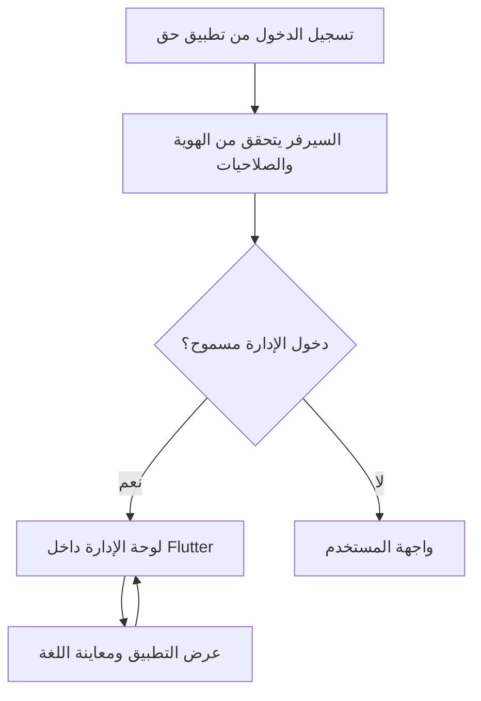

# خطة دعم 35 لغة وإدارة المحتوى من داخل تطبيق حق

تاريخ التحديث: 30 أكتوبر 2026. الحالة: بدأ التنفيذ محليًا على برانشين مستقلين عن main؛ [سجل التنفيذ](multilingual-implementation-status.md) يفصل ما نُفّذ وما لم يكتمل بعد. بنود الخطة التالية أهداف قبول، وليست إعلان اكتمال.

هذه النسخة توسّع الخطة السابقة من ست لغات إلى اللغات الـ35 المدرجة لتطبيق نسك، وتعتمد قرار المستخدم بأن لوحة الإدارة حاليًا داخل تطبيق Flutter نفسه: تسجيل الدخول بحساب له صلاحية إدارة يوجّه إلى لوحة الإدارة تلقائيًا. تبقى إدارة اللغات ونصوص الواجهة والمحتوى والتفسير والقراء والصوتيات، واختيار لغة عند أول تشغيل ثم تنزيل احتياجاتها، ضمن النطاق. تحديث نصوص الواجهة من السيرفر جزء أساسي من التصميم. الهدف النهائي اللغات الـ35؛ العربية والإنجليزية مرحلة إثبات متكاملة قبل إتاحة بقية اللغات تدريجيًا.

## 1. النتيجة المطلوبة

- يقرر الأدمن اللغات المتاحة للمستخدمين، وترتيبها واللغة المقترحة، وينشر نصوصها ومحتواها من لوحة الإدارة.
- لوحة الإدارة شاشات Flutter داخل تطبيق حق، تستخدم API محميًا في Laravel. يدخل المستخدم من شاشة الحساب نفسها؛ حساب الأدمن ينتقل إلى لوحة الإدارة، والحساب العادي إلى تجربة المستخدم.
- يستطيع الأدمن الانتقال إلى «عرض التطبيق» لمعاينة المحتوى واللغة، والعودة إلى «لوحة الإدارة» دون تسجيل خروج. صلاحياته الفعلية تحدد الأقسام والعمليات التي تظهر له.
- الحسابات تدعم ثلاثة أنواع وصول مستقلة عن الدور: ديني فقط، جمعية فقط، وجمعية وديني. تبقى أدوار الأدمن والموظفين وصلاحياتهم في Laratrust القائمة؛ لا تستبدل بمكتبة صلاحيات أخرى أو بقيمة `is_admin` محلية.
- كل المحتوى المحلي الحالي يبقى مضمّنًا في التثبيت الجديد ويعمل كما كان؛ حزم السيرفر إضافات وتحديثات اختيارية قابلة للتحقق، ولا تجعل المحتوى الحالي معتمدًا على تنزيل أولي. الملفات التي كانت تحتاج الشبكة تبقى وفق طبيعتها الحالية.
- عند أول فتح للتطبيق، يختار المستخدم لغته صراحة، ثم تبدأ حزمة البداية لهذه اللغة بالتنزيل؛ لا يحتاج إلى إنشاء حساب.
- تتغير الواجهة والاتجاه والخط والتنسيقات بحسب اللغة، وتعمل الحزمة المكتملة دون إنترنت.
- لغة المحتوى تتبع لغة الواجهة افتراضيًا، ويمكن فصلها من الإعدادات، مع اختيار مصدر ترجمة المعاني أو التفسير والقارئ بصورة مستقلة.
- يدير الأدمن التفاسير والأذكار والأدعية والأحاديث والمقالات والقراء والتلاوات والدروس والصور والترجمات والمصادر، ضمن أنواع المحتوى التي يدعمها التطبيق.
- تعديل النصوص وإضافة محتوى أو قارئ أو مصدر تفسير مدعوم يصل للمستخدم دون تحديث المتجر. إضافة وظيفة أو نوع عرض جديد أو دعم تقني جديد للغة قد يحتاج تحديث التطبيق.

## 2. أساس الخطة وحدود الفحص الحالي

أُعيد فحص الملفات المحلية في Flutter `C:\flutter_projects\haq_app` وLaravel `C:\laragon\www\haq-foundation` بتاريخ هذه النسخة. المسارات F: في النسخة القديمة ليست مسارات العمل الحالية. لم يُفحص نشر السيرفر الحي ضمن إعداد هذه الوثيقة.

| الموجود حاليًا | أثره على التنفيذ |
| --- | --- |
| لغة عربية ثابتة ونصوص مباشرة واتجاهات RTL في Flutter | يلزم استخراج النصوص وإدارة اللغة والاتجاه لكل شاشة، مع استثناء النصوص العربية الأصلية. |
| `AppAppearance` يحفظ المظهر والخط والحجم | تضاف إدارة لغة مستقلة مع المحافظة على الإعدادات الحالية. |
| `StartupFlow` يتدرج من البداية إلى التعريف ثم الرئيسية | تضاف إليه خطوة اختيار اللغة وتجهيز الحزمة قبل التعريف. |
| القرآن العربي المحلي وواجهات manifest/dataset في Laravel | يحافظ عليهما؛ حزم اللغات ليست بديلًا للنص القرآني الأصلي. |
| تفسير ومعاني وأسماء قراء من مصادر عربية محددة في الكود | تتحول إلى كتالوج موارد يديره الأدمن عبر عقود واضحة. |
| تنزيلات للصوت وصفحات المصحف مع إيقاف واستئناف وتحقق | يعاد استخدام المكونات المناسبة بعد مراجعتها؛ الكود الحالي لا يُفترض أنه يكفي لتثبيت حزم كاملة وتحديثها ذريًا. |
| قسم محتوى ديني محلي قيد التطوير وحقوله النصية مفردة | يُرحّل تدريجيًا بمعرّفات ثابتة إلى محتوى متعدد اللغات دون استبدال العمل الجاري. |
| إدارة محتوى ديني قيد العمل في Laravel: `ReligiousContentAdminController` و`ReligiousCatalog` ومسارات `v1/religious` | تُوسّع الإدارة والكتالوج الحاليان، ولا تُنشأ لوحة موازية. التخزين الحالي JSON أساسي مع نسخة إدارة في storage، ويدعم النشر والمراجع والصوت ضمن الحقول الحالية؛ اللغات والحزم والمراجعة الموسعة تضاف فوقه. |
| مزامنة محتوى ديني قيد العمل ومهاجرة مخصصة لها | تحفظ معرّفات المحتوى وحالة المستخدم وعقود المزامنة؛ لا يخلط جدول حالة المستخدم بترجمات المحتوى العام. |
| `ReligiousAccount` مستقل عن `User` الإداري؛ تسجيل الدخول الحالي يصدر رمزًا بقدرة `quran:sync`، و`ReligiousAccountOnly` يتحقق من نوع الحساب وهذه القدرة | يلزم ربط إداري صريح لحساب التطبيق مع الاحتفاظ بعزل الحسابات والمزامنة؛ الرمز الحالي ليس ترخيصًا للإدارة. |
| إدارة محتوى ويب في `routes/religious_admin.php`، و`ReligiousContentAdminController` محمي بـ`auth` و`role:superadmin` | يعاد استخدام خدمات المحتوى والتحقق، وتضاف API وشاشات إدارة Flutter. وجود صفحة ويب أو جلسة موظف لا يحقق لوحة داخل التطبيق تلقائيًا. |
| `AccountHubPage` وصفحات حساب القرآن تتعامل مع هوية المستخدم وحالته، ولا يظهر فيها مسار إدارة حالي | تضاف وجهة إدارية موحدة بعد الدخول والتحقق واستعادة الجلسة، دون إعادة بناء الحساب والنسخ والمزامنة. |

الخطة تحفظ العمل الحالي في المجلدين، وتُحدّث قائمة الملفات المتأثرة قبل كل مرحلة لأن تطوير الأقسام الأخرى جارٍ.

ملفات الارتكاز التي فُحصت: Flutter `lib/main.dart` و`lib/features/account/presentation/account_hub.dart` و`lib/features/quran/data/quran_sync.dart`، وLaravel `routes/quran.php` و`routes/religious_admin.php` و`app/Models/ReligiousAccount.php` و`app/Models/User.php` و`app/Http/Controllers/Api/ReligiousAccountController.php` و`app/Http/Middleware/ReligiousAccountOnly.php` و`app/Http/Controllers/Admin/ReligiousContentAdminController.php`. بقية الجرد التفصيلي ومطابقة المصادر تنفذ في P0.

## 3. ما الذي يتحكم به الأدمن؟

| القسم في لوحة الإدارة | الإمكانيات |
| --- | --- |
| اللغات | إضافة لغة من القدرات التي يدعمها إصدار التطبيق، الاسم الأصلي، الرمز، الاتجاه، الترتيب، الافتراضية المقترحة، إظهار/إخفاء، ومتابعة التغطية والحزم. |
| مفاتيح الواجهة | البحث والتصنيف، تعديل القيم لكل لغة، الاستيراد والتصدير، معاينة المتغيرات والجمع، ومقارنة الترجمة بالأصل. |
| المحتوى النصي | إنشاء وتصنيف وتعديل وترجمة المقالات والعناوين والأذكار والأدعية والأحاديث والشروح وربطها بالمصادر. |
| القرآن | إدارة المصادر والإصدارات المعتمدة وترجمات المعاني وربطها بالآيات؛ الأصل القرآني مسار محمي موضح أدناه. |
| التفاسير والمعاني | إدارة النوع واللغة والمصدر والمؤلف ونطاق الآيات والتغطية؛ عدم خلط التفسير بترجمة المعاني أو بمعاني المفردات. |
| المشايخ والقراء | الاسم الأصلي وترجماته والصورة والوصف والرواية والروابط والترتيب والإتاحة. |
| الصوتيات | رفع ملفات أو تسجيل مصدر خارجي موثوق، ربط السورة/الآية أو الدرس/الدعاء، اللغة والرواية والجودة الفعلية والمدة والحقوق. |
| الصور والملفات | رفع ومعاينة وربط بالنص أو اللغة مع وصف بديل مترجم عند الحاجة. |
| حزم اللغات | تحديد محتوى حزمة البداية والمصادر الافتراضية والحزم الاختيارية، توليدها والتحقق منها ونشر إصدار أو الرجوع عنه. |
| المراجعة والسجل | مسودة، قيد المراجعة، معتمد، منشور، مؤرشف؛ سجل من غيّر ماذا ومتى، ومعاينة الفروقات واسترجاع إصدار. |

صلاحيات مستقلة مقترحة: إدارة اللغات، تحرير النصوص، تحرير المحتوى، رفع الوسائط، مراجعة، نشر، إدارة المصادر، واستيراد أصل قرآني معتمد. يمكن منح عدة صلاحيات للشخص نفسه؛ ينفذ السيرفر التحقق منها لكل عملية.

### 3.1 لوحة الإدارة داخل التطبيق وتوجيه الحساب

- بعد نجاح الدخول بالبريد أو Google المهيأ، يجلب التطبيق ملف الجلسة وصلاحياتها من السيرفر قبل اختيار الوجهة. في الدخول الأول للأدمن تكون الوجهة لوحة الإدارة، ولا يلزم تسجيل دخول يومي ثانٍ للإدارة.
- عند إعادة فتح التطبيق، يتحقق من الجلسة والصلاحيات قبل إعادة فتح الإدارة. إذا تعذر الاتصال، يبقى المحتوى العام والمحلي متاحًا، وتظهر حالة تعذر التحقق من الإدارة دون السماح بنشر أو تعديل غير متصل.
- التحويل يحدث مرة لكل دخول أو استعادة جلسة، فلا يعيد الأدمن من «عرض التطبيق» إلى اللوحة مع كل إعادة بناء للشاشة. يمكن إعادة دخول اللوحة من الحساب أو قائمة «المزيد».
- الرابط المباشر إلى شاشة إدارة يمر بالتحقق نفسه. عند انتهاء الجلسة، يحتفظ بوجهة العودة الآمنة بعد تجديدها. عند سحب الصلاحية، يغلق السياق الإداري ويعود للتجربة العادية؛ الخروج يلغي الجلسات المحلية الإدارية ويمنع استجاباتها المتأخرة.
- لا يظهر زر الإدارة للحساب العادي؛ منع الوصول ينفذ أيضًا في كل طلب للسيرفر، بما في ذلك رفع الملفات ومعاينة المسودات وتصديرها.
- واجهة اللوحة تتبع لغة التطبيق. أول تسليم إداري مكتمل بالعربية والإنجليزية؛ تُستخرج نصوصها أيضًا ضمن مشروع اللغات الـ35، ويعرض تقرير التغطية الواجهة العامة والإدارة كلًا على حدة.

### 3.2 ربط حساب الأدمن الحالي دون خلط الهويات

وفق تصحيح المستخدم عند بدء التنفيذ: `User` لحساب الجمعية والموظف، و`ReligiousAccount` للحساب الديني. يضيف `AppAccount` طبقة ربط دون نقل كلمات المرور: ديني فقط، جمعية فقط، أو جمعية وديني. يرتبط المنح في `app_admin_memberships` بحساب التطبيق المجمع، ويُحسب الوصول الإداري من تقاطع المنح مع صلاحيات Laratrust الحالية ونطاق اللغة. لا يستنتج الربط من تطابق البريد أو الاسم، ولا يستطيع التسجيل العام أو تعديل الملف الشخصي إنشاء منح إداري.

1. تهيئة منح الأدمن الأول تتم بإجراء خادمي موثق؛ لا حساب افتراضي بكلمة مرور ثابتة. الربط الاختياري من داخل التطبيق يحتاج إعادة إثبات هوية الحساب الحالي وكلمة مرور الحساب الآخر، ويحافظ على بيانات الحساب الديني ومعرّفاته ويلغي جلسات التطبيق السابقة. لا تكفي جلسة قديمة أو تطابق البريد لربط الحسابين.
2. دخول الحساب المرتبط يفحص نشاط الحسابين والمنح والصلاحيات الحالية. صلاحيات التطبيق هي تقاطع المنح مع الصلاحيات الإدارية المسموح بها لهذه الوحدة، ولا تمنح الوصول إلى بقية إدارة الجمعية تلقائيًا.
3. تستمر رموز المزامنة الشخصية الحالية وعقودها دون منح إدارة. جلسة `AppAccount` لمدة 30 يومًا، وسياق الإدارة لمدة 30 دقيقة مرتبط بها؛ تغيير كلمة مرور المصدر أو سحب المنطقة أو المنح يبطل الطلبات التابعة. لا يمدد امتياز الإدارة إلى عمر رمز المزامنة الحالي البالغ 90 يومًا.
4. ملف الجلسة يعيد قدرات صريحة مثل `admin_access` و`permissions` وحالة الانتهاء. تستخدمها الواجهة للتوجيه، لكن السيرفر يعيد فحص المنح والصلاحية المطلوبة لكل عملية؛ قيمة `is_admin` محلية أو قدرة محفوظة في رمز قديم لا تكفي.
5. حقل الدور أو الربط الإداري لا يقبل من استمارة التسجيل أو Google أو تحديث الملف أو استيراد نسخة المستخدم. تغيير الصلاحيات له سجل تدقيق، ويوقف سحبها الطلبات التالية حتى لو بقي الرمز محفوظًا.
6. تحفظ جلسة التطبيق في التخزين الآمن وتستثنى من النسخ والمشاركة والسجلات؛ سياق الإدارة القصير في الذاكرة فقط. مسودات الإدارة لا تدخل حزم المستخدم أو نسخه، وتُحجب شاشاتها عند الخروج أو تغير الهوية.

التنفيذ الحالي لهذه الطبقة محلي واختباري، ويتطلب migration مخصصة وتهيئة على السيرفر قبل استعمال الحسابات الحقيقية. لا يُستبدل تسجيل دخول المستخدمين الحاليين ولا تُضعف حمايات الويب القائمة. نوع الوصول للجمعية لا يعني أن جميع وحدات موقع الجمعية نُقلت إلى Flutter؛ نقلها ليس ضمن خطة ترجمة المحتوى الديني.

### 3.3 شاشات الإدارة في أول تسليم

| الشاشة | محتواها والعمليات الأساسية |
| --- | --- |
| الرئيسية الإدارية | تغطية اللغات، الترجمات الناقصة، مواد تنتظر المراجعة، حالة بناء الحزم، وآخر عمليات النشر. |
| اللغات | قائمة قابلة للبحث، فتح تقرير لغة، حالتها وترتيبها واتجاهها وتوافقها وتفعيلها بعد اجتياز بوابة النشر. |
| ترجمة الواجهة | اختيار قسم ولغة، الأصل والترجمة جنبًا إلى جنب بحسب مساحة الشاشة، بحث عن المفاتيح والناقص، حفظ مسودة ومعاينة واستيراد/تصدير بصيغ معتمدة. |
| المحتوى والمصادر | إنشاء وتحرير الأصل والترجمات والتصنيفات، نسب المصدر، نطاق التغطية، والقراء والتفسير والصوتيات والوسائط. |
| المراجعة والنشر | فروقات النسخة، نتائج التحقق، اعتماد أو إرجاع للمحرر، بناء الحزمة، متابعة المهمة، النشر والرجوع لإصدار صالح. |
| الفريق وسجل العمليات | المنح والنطاقات والسجل وفق صلاحيات مستقلة؛ محرر ترجمة لا يمنح نفسه صلاحية النشر أو إدارة الفريق. |

تستخدم الواجهة قوائم ونماذج مناسبة للهاتف، ومقارنة أوسع على الشاشة الكبيرة. حفظ مسودة لا ينشرها. الرفع والبناء يعرضان حالة فعلية قابلة لإعادة المحاولة، والتعديل المتزامن يفحص رقم المراجعة ويعيد تعارضًا واضحًا بدل الكتابة فوق عمل مسؤول آخر. نطاق هذه الخطة إدارة لغات حق ومحتواه وما يلزمها من فريق؛ لا تعني نقل كل وحدات موقع الجمعية إلى التطبيق في هذه المرحلة.

### حدود التعديل والمصادر

- المفاتيح لها معنى برمجي ثابت. الأدمن يعدّل ترجمتها، لكن مفتاحًا جديدًا لا يظهر في شاشة حتى يستخدمه التطبيق أو نوع محتوى مدعوم. لا يُسمح بحذف مفتاح مطلوب أو تغيير نوع متغيراته من لوحة التحرير.
- محتوى تديره الجمعية يمكن تحريره ومراجعته ونشره. محتوى خارجي يُدار اختياره ومصدره وإتاحته؛ تعديل نسخته يحتاج استضافة نسخة مصرح بها مع بيان نسبتها، ولا يغيّر المصدر الخارجي.
- النص القرآني العربي الأصلي يبقى مطابقًا للمصدر الموثق، ولا يكون حقل تحرير يومي. التصحيح الضروري عبر استيراد إصدار معتمد، وفحص الآيات والمراجع والبصمات ومراجعة قبل النشر وإمكانية الرجوع.
- الأصل العربي للأدعية والأحاديث محفوظ مع المصدر، ويمكن تصحيحه عبر مراجعة وإصدار. الترجمة مرتبطة به ولا تستبدله.
- تسجيل سورة كاملة لا يكفي لتشغيل كل آية أو تكرارها؛ هذه الوظائف تحتاج ملفات آيات أو توقيتات موثقة. لا تُختلق مدد أو جودات أو توقيتات.
- اعتماد مصادر المحتوى وحقوق عرضه وإعادة توزيعه وترجمته وتنزيله يتم قبل ضمه للحزم. لا نفترض أن كل مصدر خارجي يسمح بالتنزيل الجماعي.
- التسجيلات العربية تبقى كما هي عند تغيير لغة الواجهة. صوت بلغة أخرى مورد مستقل؛ لا يولّد تغيير اللغة صوت شيخ أو ترجمة صوتية تلقائيًا.

## 4. اللغات وسياسة إتاحتها

القائمة المرجعية هي اللغات الـ35 في [صفحة نسك على App Store](https://apps.apple.com/sa/app/nusuk-%D9%86%D8%B3%D9%83/id6469515422)، التي روجعت في هذه المحادثة. تعداد المتجر مرجع لقائمة الاستهداف، ولا يثبت اكتمال جميع خدمات نسك بكل لغة. الرموز أدناه مقترحة للتبادل وتطابق مع إمكانات SDK ومصادر المحتوى قبل تثبيت العقد.

| # | اللغة | الرمز المقترح | الاتجاه |
| --- | --- | --- | --- |
| 1 | العربية | `ar` | RTL |
| 2 | الإنجليزية | `en` | LTR |
| 3 | الأمهرية | `am` | LTR |
| 4 | الأذربيجانية | `az`، لاتيني مبدئيًا | LTR |
| 5 | البنغالية | `bn` | LTR |
| 6 | البوسنية | `bs` | LTR |
| 7 | البورمية | `my` | LTR |
| 8 | الفلبينية | `fil` | LTR |
| 9 | الفرنسية | `fr` | LTR |
| 10 | الألمانية | `de` | LTR |
| 11 | الغوجاراتية | `gu` | LTR |
| 12 | الهوسا | `ha`، لاتيني مبدئيًا | LTR |
| 13 | الهندية | `hi` | LTR |
| 14 | الإندونيسية | `id` | LTR |
| 15 | اليابانية | `ja` | LTR |
| 16 | الكازاخية | `kk`؛ يحسم نظام الكتابة في P0 | حسب نظام الكتابة المعتمد |
| 17 | الكورية | `ko` | LTR |
| 18 | الكردية | يحسم `ku-Latn` أو `ckb` في P0 | LTR أو RTL بحسب الاختيار |
| 19 | الملايوية | `ms`، لاتيني مبدئيًا | LTR |
| 20 | المالايالامية | `ml` | LTR |
| 21 | البشتوية | `ps` | RTL |
| 22 | الفارسية | `fa` | RTL |
| 23 | البرتغالية | `pt`؛ تحسم النسخة الإقليمية في P0 | LTR |
| 24 | الروسية | `ru` | LTR |
| 25 | الصينية المبسطة | `zh-Hans` | LTR |
| 26 | السنهالية | `si` | LTR |
| 27 | الصومالية | `so` | LTR |
| 28 | الإسبانية | `es` | LTR |
| 29 | السواحيلية | `sw` | LTR |
| 30 | التاميلية | `ta` | LTR |
| 31 | التيلوغوية | `te` | LTR |
| 32 | التايلاندية | `th` | LTR |
| 33 | التركية | `tr` | LTR |
| 34 | الأردية | `ur` | RTL |
| 35 | الأوزبكية | `uz`، لاتيني مبدئيًا | LTR |

- يجهز سجل اللغات والبنية للاستهداف الكامل منذ البداية: الاتجاه، تنسيقات النظام، صيغ الجمع، الخطوط، وعرض النص. يسجل P0 ما تدعمه مكتبات النسخة المثبتة وما يحتاج موارد ترجمة أو مفوضات أو خطوطًا إضافية؛ لا يفترض وجود دعم مدمج كامل للـ35 لغة.
- تبدأ الإتاحة العامة بالعربية والإنجليزية بعد اكتمال الواجهة العامة ولوحة الإدارة وحزمة البداية. ترتيب اللغات الـ33 الأخرى يحدد وفق توفر المراجعين والمصادر واحتياج الجمهور، وليس ادعاء وجود ترجمات جاهزة الآن. الهدف المكتمل بنهاية P6 هو نشر اللغات الـ35.
- اختيار لهجة أو نظام كتابة واحد للكردية لا يعني دعم كل الكردية. يسجل القرار والاسم الأصلي والرمز والاتجاه في العقد؛ إضافة تنويعة أخرى توسعة مستقلة، وكذلك الصينية التقليدية أو أنظمة الكتابة الأخرى.
- لكل لغة مصفوفة مستقلة: الواجهة العامة، نصوص الإدارة، أخطاء API والإشعارات، محتوى البداية، ترجمة المعاني، التفسير، والوسائط. النسبة الإجمالية لا تخفي نقص قسم؛ ترجمة الواجهة لا تعني توفر تفسير أو صوت مترجم.
- لا تُعرض لغة لمجرد أن الأدمن أضاف اسمها. يشترط اكتمال المفاتيح المطلوبة والحزمة الأساسية، ومراجعتها، وتوافقها مع إصدار التطبيق.
- يستطيع الأدمن نشر لغة أخرى من اللغات المهيأة دون تحديث المتجر. لغة خارج قدرات النسخة تحتاج تقييمًا وقد تحتاج تحديثًا، حتى لو أمكن إدخال نصوصها في لوحة الأدمن.
- قائمة اللغات في التطبيق ناتجة عن تقاطع ما نشره الأدمن وما يدعمه إصدار التطبيق؛ لا يحاول التطبيق تشغيل حزمة غير متوافقة.
- اختيار الأدمن للغة افتراضية اقتراح لأول استخدام، ولا يستبدل اختيار المستخدم الصريح. ترتب شاشة البداية الاقتراح وفق لغة الجهاز المدعومة، ثم افتراضية الأدمن، ثم العربية.
- إذا أخفى الأدمن لغة مستخدمة حاليًا، لا تُحذف ملفاتها تلقائيًا ولا تتغير لغة المستخدم بصمت؛ عند الاتصال التالي يُشرح وضعها وتُتاح لغة منشورة بديلة. لا يمكن سحب محتوى من جهاز غير متصل فورًا.
- لا يسمح بإخفاء آخر لغة صالحة أو سحب آخر حزمة بدء متوافقة دون بديل. الرجوع المضمّن للعربية والإنجليزية يضمن قابلية تشغيل التطبيق عند تعذر السيرفر.
- لا تُنشر ترجمة آلية غير مراجعة للنصوص الدينية. يمكن استعمالها مسودة تحريرية فقط ضمن مسار مراجعة معتمد، واكتمال المفاتيح لا يعني اكتمال المحتوى.
- يمكن إعداد مسودات آلية لنصوص الواجهة أيضًا، لكن لا تنشر حتى تراجع لغويًا وتفحص المتغيرات والجمع والسياق. المحتوى الذي لا تتوفر ترجمته يعرض أصله مع بيان واضح أو حالة عدم توفر؛ لا يُعرض نص عربي تحت وصف يوحي بأنه ترجمة.

## 5. تجربة المستخدم عند أول تشغيل

التسلسل المقترح: شاشة البداية ← اختيار اللغة ← تجهيز الحزمة ← التعريف بالتطبيق باللغة المختارة ← الرئيسية.

1. يحتوي التطبيق الموزع على نصوص بدء أساسية بالعربية والإنجليزية وبيانات تعريف اللغات المهيأة، بحيث يمكن عرض الاختيار حتى قبل تنزيل أي شيء.
2. يجلب قائمة اللغات والحزم المنشورة من السيرفر بمهلة محدودة، مع استخدام آخر قائمة صالحة أو القائمة المضمّنة عند تعذر الشبكة. تظهر الخيارات المتاحة محليًا وتميّز الخيارات التي تحتاج تنزيلًا.
3. تعرض كل لغة باسمها الأصلي، مع اقتراح لغة الجهاز عند توفرها، ويؤكد المستخدم اختياره. لا يطلب تسجيل الدخول ولا تُختار لغة بصمت.
4. تعرض الشاشة حجم التنزيل الفعلي والمتاح من المحتوى وخيار استخدام بيانات الهاتف. زر «متابعة وتجهيز [اللغة]» يبدأ تنزيل حزمة البداية مباشرة؛ لا يوجد تأكيد ثانٍ للتنزيل نفسه.
5. إذا كانت الحزمة موجودة بالإصدار الصحيح، يعاد استخدامها ولا تُنزّل مرة أخرى. العربية لا تعيد تنزيل النص القرآني المضمّن، والإنجليزية لا تحتاج تنزيل بقية اللغات.
6. تظهر حالة مفهومة: جاري التنزيل، تقدم بالبايت والحجم الكلي، تحقق، جاهز، متوقف، أو تعذر. لا يعرض زمنًا متبقيًا مختلقًا.
7. يكتمل الدخول بالحزمة المختارة بعد التحقق منها وتفعيلها كوحدة واحدة. لا يُعلَن أن المحتوى جاهز قبل تثبيت الملفات والفهرس اللازمين.
8. يستطيع المستخدم إيقاف التنزيل أو إعادة المحاولة أو «الإكمال بالمحتوى المتاح». لا يُمنع من التطبيق عند انقطاع الإنترنت؛ يُشرح ما لم يُنزّل وتُستخدم اللغة المحلية الصالحة بعد توضيحها. يبقى اختياره المطلوب محفوظًا لاستكماله لاحقًا.
9. يُحفظ اكتمال الإعداد واختيار اللغة وحالة الحزمة بصورة منفصلة؛ إعادة فتح التطبيق بعد انقطاع أو إغلاق لا تعيد التعريف ولا تفقد تقدم التنزيل.
10. للمستخدمين الحاليين، تبقى العربية والبيانات كما هي ويظهر تعريف مختصر بإعداد اللغة الجديد؛ لا تعاد تجربة التثبيت الأول إجبارياً.

واجهة الاختيار تعتمد أسماء اللغات الأصلية؛ الرسائل المطلوبة قبل اكتمال تنزيل لغة أخرى لها نصوص بدء مضمّنة ومراجعة للغات المستهدفة. لا تحتاج شاشة الترحيب تحميل خط من الشبكة حتى يستطيع المستخدم قراءة اختياره.

## 6. ماذا يُنزّل مباشرة للغة المختارة؟

حزمة البداية محددة وصغيرة نسبيًا، وحجمها الحقيقي يُحسب عند البناء. لا تعني «جميع ملفات اللغة»، ولا تُختلق أرقام أحجام في التصميم قبل تجهيز المحتوى.

| المورد | سياسة التنزيل |
| --- | --- |
| نصوص واجهة اللغة المنشورة | تلقائي ضمن حزمة البداية، مع موارد بداية مضمّنة للرجوع. |
| بيانات الأقسام وأسماء السور والقراء والعناوين المترجمة | تلقائي؛ بيانات التعريف فقط للموارد الكبيرة. |
| أذكار وأدعية أساسية مع الأصل والترجمة والمصادر | تلقائي ضمن قائمة بداية يعتمدها الأدمن، مع بيان نطاقها. |
| ترجمة معاني القرآن الافتراضية للغة | تلقائي ضمن الحزمة إذا توفر مصدر معتمد يسمح بإعادة التوزيع وحجم مناسب؛ وإلا تُعلن غير متاحة ويُتاح ما هو مرخص فقط. نشر اللغة يحتاج قرارًا ظاهرًا بشأن هذا النقص. |
| فهرس البحث المحلي وبيانات نسبة المصادر | تلقائي للمحتوى الذي نُزّل فعلًا؛ لا يدعي البحث تغطية محتوى غير موجود. |
| الخط اللازم لقراءة الحزمة | تبعية أساسية إن لم يكن مضمّنًا؛ تحسب مساحته ويتحقق من تغطيته وترخيصه. |
| النص القرآني العربي الموجود في التطبيق | يعاد استخدامه دون تنزيل أو تغيير بسبب اللغة. |
| التفاسير الكاملة والموسوعات والترجمات الإضافية | اختيارية مع حجم ونطاق واضحين؛ تُحمّل أيضًا عند الطلب وفق المصدر. يمكن ضم مقتطفات بداية معتمدة دون الادعاء أنها تفسير كامل. |
| التلاوات والدروس والأدعية الصوتية | بث عند الطلب، وتنزيل اختياري بحسب القارئ أو السورة/الآيات أو التسجيل. لا تُنزّل جميع أصوات المشايخ عند اختيار اللغة. |
| صور صفحات المصحف والخطوط الثقيلة والصور عالية الدقة | اختيارية حسب نمط القراءة؛ لا تحجب القراءة النصية الأساسية. |

يستطيع الأدمن اختيار مكونات حزمة البداية ضمن ميزانية حجم تضبط في النظام بعد قياس الملفات. الحزم الضخمة لا تتحول إلى تنزيل تلقائي لمجرد إضافتها؛ يظهر تقرير الحجم قبل النشر وتفصل إلى حزم اختيارية. لا تنشر الحزمة بحقل «جاهزة» إذا غابت تبعية مطلوبة.

## 7. إعدادات المستخدم وإدارة المساحة

- لغة التطبيق: الاختيار من اللغات المنشورة والمتوافقة، مع تطبيق فوري إذا كانت الحزمة محلية؛ وإلا تجهيزها أولًا.
- لغة ترجمة المحتوى: «تتبع لغة التطبيق» افتراضيًا أو لغة مستقلة، مع اختيار مصدر المعاني والتفسير ووضع الأصل مع الترجمة.
- التنزيلات: الحزم المثبتة وإصداراتها والحجم الفعلي والتحديثات، وإيقاف واستئناف وإعادة محاولة، وحذف الحزم الاختيارية أو غير المستخدمة بعد تأكيد.
- الشبكة: تنزيل حزمة البداية عند المتابعة مع توضيح استهلاكها؛ التنزيلات الكبيرة والتحديثات التلقائية عبر Wi-Fi افتراضيًا، مع خيار صريح لبيانات الهاتف. إذا تعذر معرفة نوع الشبكة، يُطلب اختيار واضح داخل إعداد التنزيل.
- تغيير اللغة لا يحذف الحزمة السابقة أو التلاوات ولا يغير موضع القراءة والمفضلة. لا تُحذف حزمة مستخدمة من لغة الواجهة أو لغة المحتوى أو تبعية مشتركة إلا بعد توفير بديل.
- حساب المساحة يمنع تكرار النص العربي أو الملف الصوتي المشترك بين لغتين. تنظيف حزمة غير مستخدمة لا يحذف ملفًا مشتركًا ما زال مطلوبًا.
- اللغة إعداد محلي يعمل للضيف والحساب. مزامنتها بين الأجهزة ليست تلقائية في الإصدار الأول حتى لا يتغير جهاز آخر بصورة مفاجئة.

## 8. تصميم الترجمة في Flutter

1. إنشاء مسؤول للغة واختيار المحتوى، وربطه بجذر التطبيق و`StartupFlow` والإعدادات، دون ربطه بحالة تسجيل الدخول.
2. تعريف سجل مفاتيح ثابت ذي أنواع ومتغيرات، مع موارد مضمّنة للعربية والإنجليزية ونصوص البدء المطلوبة. تراجع تفاصيل الحزم والمكتبات وفق SDK المثبت وقت التنفيذ.
3. إضافة طبقة ترجمة وقت التشغيل تقرأ الحزم المنشورة من السيرفر. الاعتماد على ARB مولّد داخل التطبيق وحده لا يحقق تعديل الأدمن للنصوص دون تحديث المتجر.
4. اعتماد صيغة واحدة للرسائل والمتغيرات والجمع والتحقق منها في السيرفر والتطبيق. لا ينفذ التطبيق تعليمات أو شيفرة أو قوالب واجهات من ملفات الترجمة، ولا يسمح بروابط أو HTML غير مضبوط ضمن نصوص الواجهة.
5. ترتيب الرجوع عند غياب مفتاح: قيمة اللغة المنشورة الصحيحة، ثم نسخة محلية صالحة من اللغة نفسها، ثم المورد المضمّن المحدد. يُمنع نشر حزمة ناقصة المفاتيح المطلوبة، ويسجل العجز دون عرض اسم المفتاح للمستخدم.
6. الكلمات الأطول وصيغ الجمع والتواريخ والأرقام وقارئ الشاشة ورسائل الأخطاء والمشاركة وبيانات مشغل الخلفية تدخل في حصر النصوص.
7. اتجاه الواجهة يتبع اللغة؛ النص القرآني والأصل العربي يظلان RTL، والترجمة تتبع اتجاهها. تراجع الأسهم والتنقل والصوت والأزمنة بصورة مستقلة حتى لا ينقلب معناها.
8. البحث يفصل النص المعروض الأصلي عن النص المعالج للفهرسة، ويستخدم معالجة مناسبة لكل لغة. لا تستخدم إزالة التشكيل وتسويات العربية كحل عام للتركية أو الصينية أو الروسية.
9. Flutter ونظام التشغيل يعرضان رسائل وعناصر مدمجة ليست من مفاتيح الأدمن، مثل بعض قوائم النظام. تجهز مفوضات ترجمتها للغات المدعومة ويُعلن أن تخصيصها ليس كله متاحًا من لوحة الإدارة.

## 9. نموذج البيانات وعقود Laravel المقترحة

الأسماء التالية تصميم أولي يُطابق مع المخطط الحالي قبل إنشاء migrations؛ لا تعني وجود الجداول الآن. يتضمن P0 خطة نقل كتالوج JSON الإداري الحالي إلى التخزين المناسب مع إبقاء واجهة الخدمة ومعرّفاتها ونسخة رجوع، أو توسيعه مؤقتًا إذا احتاج الانتقال مراحل. لا يُفعّل مصدرا كتابة مستقلان للمحتوى نفسه، ولا تُنسخ صفحات الإدارة الحالية في نظام موازٍ.

| المجموعة | الكيانات المقترحة ومسؤوليتها |
| --- | --- |
| اللغات والواجهة | `app_languages`، `ui_translation_keys`، `ui_translation_values`: سجل القدرات والظهور وقيم المفاتيح وإصداراتها. |
| المحتوى | `content_items`، `content_translations`، التصنيفات وروابطها: معرّفات ثابتة ونص أصلي وترجمة ومصدر وحالة مراجعة. |
| المصادر القرآنية | `content_sources`، موارد النص القرآني وترجمات المعاني والتفسير وروابط السورة/الآية ونطاقاتها. لا يفترض أن كل تفسير يغطي آية واحدة فقط. |
| الأشخاص والوسائط | `reciters`/المشايخ، `media_assets`، `audio_tracks`: ملف أو مصدر، الربط بالمحتوى، الرواية واللغة والنسخة والبيانات الفعلية. |
| النشر والحزم | `content_revisions`، `package_releases`، `package_assets`، وسجل تدقيق: نسخ ثابتة واعتماد وتبعيات وبصمات ونتائج بناء. |
| الهوية ومنح الإدارة داخل التطبيق | `app_accounts` يربط حساب الجمعية والحساب الديني بصلاحيات منطقتين مستقلتين؛ `app_admin_memberships` يحدد المنح ونطاق اللغات ويتقاطع مع أدوار وصلاحيات Laratrust. لا تُنسخ كلمات المرور أو بيانات القرآن الشخصية. |

تفصل هوية المحتوى عن ترجمته، ولا يضاف عمود لكل لغة. تحافظ الترحيلات على معرفات `surah:ayah` ومعرفات المحتوى المحلي الموجودة؛ المفضلة والتقدم لا يرتبطان بنص مترجم قابل للتغيير. ترجمات المعنى أو التفسير لها هوية مصدر وإصدار مستقلة.

عقود عامة جديدة مقترحة ضمن مساحة مثل `/api/v2/app-content`؛ الاسم والمسار النهائيان يحسمان أثناء مرحلة العقد. لا تستبدل مسارات القرآن والحساب و`v1/religious` الحالية بصورة تكسر العملاء القدامى؛ تُحوّل الخدمات القائمة إلى المصدر المعتمد نفسه مع الحفاظ على شكل استجاباتها القديمة.

| العملية | الاستجابة المطلوبة |
| --- | --- |
| Bootstrap | اللغات المنشورة المتوافقة، الافتراضية المقترحة، إصدار الكتالوج، قدرات الحزم وروابطها. لا يعتمد على تنزيل حزمة مسبقًا. |
| Manifest لغة | حزمة البداية والحزم الاختيارية، الأحجام والتبعيات والمصادر والحد الأدنى لإصدار العميل والبيانات المطلوبة للتحقق. |
| كتالوج المحتوى | النوع والتصنيف واللغة المطلوبة والفعلية وتوفر الترجمة والمصادر مع ترقيم صفحات واضح. |
| المحتوى والتفسير | الأصل والترجمة ومرجع الآية/النطاق والمصدر وحالة fallback، دون إعادة تسمية النص العربي على أنه إنجليزي. |
| كتالوج الصوتيات | القراء والروايات والملفات المتاحة فعليًا واللغات والروابط والجودات والتوقيتات عند توفرها. |
| فحص التحديثات | الإصدارات المنشورة المتوافقة والتغييرات والسحب أو الأرشفة، مع فصل تحديث المحتوى عن تحديث التطبيق. |

يشمل العقد `requested_locale` و`resolved_locale` و`fallback_reason` عند الحاجة. الأخطاء لها رموز ثابتة يترجمها التطبيق، واللغة غير المدعومة لا تتحول بصمت إلى استجابة تبدو مترجمة.

طلبات لوحة الإدارة تقتصر على المستخدم الإداري وصلاحياته، بينما قائمة اللغات وحزم المحتوى العام تعمل للضيف. إعدادات الموقع المترجم الحالية لا تكفي وحدها لتطبيق هذا العقد.

### 9.1 عقد API للوحة Flutter

المسارات التالية مقترحات توثق في P0، وليست endpoints موجودة أو تغييرات منفذة. تعاد الاستفادة من خدمات Laravel الحالية بدل محاكاة نماذج الويب أو تحميل لوحة ويب داخل WebView.

| المجموعة | عقد مقترح | الضوابط والنتيجة |
| --- | --- | --- |
| هوية الجلسة | توسيع ملف الحساب القائم أو مسار مثل `GET /api/v2/session` | هوية حساب التطبيق، حالة جلسة الإدارة وصلاحياتها وتوجيهها؛ يبقى العملاء القدامى قادرين على استخدام استجاباتهم الحالية. |
| سياق الإدارة | `POST /api/v2/admin/session` وتجديده/إلغاؤه | يتحقق من الجلسة والمنح الصريح، ويصدر سياقًا قصيرًا محدودًا؛ تحديث الصلاحيات لا يعتمد على ذاكرة العميل. |
| الملخص واللغات | `/api/v2/admin/overview` و`/languages` | إحصاءات فعلية، تغطية حسب القسم، الفرز والحالة والتوافق؛ صلاحيات القراءة والتحرير والنشر مستقلة. |
| الترجمة والمحتوى | `/api/v2/admin/ui-translations` و`/content` و`/sources` | تصفية اللغة والحالة، صفحات نتائج، تحقق من المفاتيح والمتغيرات والمراجع، ومراجعة متزامنة برقم إصدار؛ التعارض يعاد مثل `409`. |
| الوسائط والاستيراد | `/api/v2/admin/uploads` و`/imports` | تحقق خادمي من النوع والحجم والمصدر، تقرير أخطاء قابل للتنزيل، ومعاينة قبل تطبيق استيراد جماعي؛ إعادة المحاولة لا تكرر المواد. |
| المراجعة والحزم | `/api/v2/admin/reviews` و`/releases` و`/jobs` | مراجعة واعتماد وبناء ومتابعة ثم نشر/رجوع؛ طلب النشر المتكرر لنفس العملية لا ينشئ إصدارات متعارضة. |
| الفريق والسجل | `/api/v2/admin/memberships` و`/audit` | لمسؤول مخول فقط؛ لا رفع ذاتي للامتيازات، مع تدقيق التغيير وربطه بالحساب والعملية. |

كل المسارات الإدارية تتحقق من هوية الحساب وسياق الإدارة والمنح الحالي ثم صلاحية العملية ونطاقها. مسار عام أو رمز `quran:sync` وحده لا يقرأ المسودات أو ينشر محتوى. رموز الأخطاء ثابتة وقابلة للترجمة؛ يميز التطبيق بين انتهاء الجلسة `401` وغياب الصلاحية `403` وتعارض التحرير وفشل التحقق، دون فقد نص المسودة في حالات الخطأ القابلة للاستعادة داخل الجلسة نفسها. النصوص المنشورة وحدها تدخل حزم المستخدم العام؛ أسماء الفريق وبيانات المنح وسجل العمليات والمسودات لا تدخل الحزم العامة أو نسخ المستخدم.

## 10. بناء الحزم وتثبيتها وتحديثها

- تُبنى الحزم من لقطة محتوى معتمدة، عبر مهمة سيرفر مستقلة، وتخزن كملفات ثابتة قابلة للتوزيع من التخزين أو CDN عند الحاجة. لا تُجمع حزمة ضخمة داخل طلب شاشة الأدمن.
- حالات البناء والنشر منفصلة: مسودة، بناء، تحقق، جاهزة للنشر، منشورة، فاشلة، مسحوبة. لا تظهر اللغة للعامة حتى تنجح حزمة بدايتها.
- كل manifest يتضمن: `package_id`، اللغة ونوع المورد، إصدار غير قابل للاستبدال، نسخة المخطط، توافق العميل، التبعيات، قائمة الملفات وروابطها وأحجامها وبصماتها ومصدرها وحقوقها، والحجم بعد فك الضغط إن وجد.
- تُوثق manifests الموزعة بآلية تحقق موثوقة مضمّنة في التطبيق، وتستخدم HTTPS؛ البصمة وحدها تكشف تلف الملف ولا تثبت ناشره. يتضمن التنفيذ إدارة مفاتيح النشر وتدويرها دون تمكين محرر النصوص من تبديلها.
- يبدأ التطبيق بملفات مؤقتة، ويتحقق من المساحة اللازمة للملف والنسخة المستخرجة والنسخة السابقة، ويمنع المسارات الخارجة عن مجلد الحزمة وملفات الأرشيف غير المتوقعة.
- يدعم التنزيل الإيقاف والاستئناف بعد إعادة التشغيل. يتحقق من نطاق الاستجابة وهوية الإصدار قبل إلحاق البايتات؛ رابط انتهت صلاحيته يجدد لنفس المورد، وتغير المصدر أو النسخة لا يدمج ملفين.
- تُفحص البصمات والمراجع والمخطط والتبعيات والفهارس، ثم تفعل الحزمة ذريًا. تبقى آخر نسخة سليمة حتى يكتمل الجديد، وينظف المؤقت بصورة قابلة للاستئناف.
- الإصدار المنشور ثابت. تصحيح نص أو تبديل ملف صوت ينشئ إصدارًا جديدًا؛ يمكن إعادة نشر لقطة سابقة داخل إصدار أحدث للاسترجاع المنضبط. لا تتصادم البصمات والروابط مع ملفات قديمة.
- تشمل مفاتيح التخزين المؤقت اللغة والمصدر ومعرف المورد والإصدار؛ اختلاف اللغة في الترويسة مع URL واحد لا يجوز أن يخلط الاستجابات.
- يبدأ التنفيذ بحزم كاملة مستقلة للموارد المتغيرة، وتنزيل الملفات الجديدة أو المتغيرة فقط عند إمكان ذلك. التصحيحات الثنائية الجزئية ليست شرطًا للإصدار الأول.
- التحديثات العادية لا توقف القراءة أو التشغيل الجاري؛ تطبق عند نقطة مناسبة، وتظهر التغييرات المهمة. الرجوع لإصدار صالح لا يغير حساب المستخدم أو العلامات.
- إخفاء محتوى يوقف عرضه في الكتالوج المتصل عند وصول التحديث؛ يحتفظ بمرجع المفضلة مع بيان عدم الإتاحة. الحذف المحلي للمحتوى المسحوب سياسة معلنة، وليس وعدًا بحذف فوري من الأجهزة غير المتصلة.
- يبقى حساب المستخدم الديني ومزامنته منفصلين عن تحديث المحتوى العام؛ لا يُحمّل محتوى خاص داخل حزمة عامة.

## 11. التفسير والصوت: عقود الإضافة دون تحديث التطبيق

- ينشر الأدمن مصدرًا من محول يدعمه السيرفر أو يرفع محتوى بالصيغة الداخلية. مصدر خارجي جديد بصيغة مختلفة يحتاج محولًا وتحققًا في الباك؛ لا يكفي لصق رابط API كيفما كان.
- روابط الرفع والمصادر تتحقق في السيرفر: نوع وحجم الملف، مرجع الآية أو السورة، نطاق اللغة، HTTPS ومضيف مسموح، وصحة الوسيط. لا يفتح جلب روابط داخلية أو عشوائية عبر API عام.
- إنشاء أسماء القراء والتراجم مرن، مع منع تكرار الهوية بسبب اختلاف لغة الاسم. حذف قارئ أو مصدر مرتبط يتحول إلى أرشفة أو إخفاء بدل كسر التسجيلات والمفضلة.
- يفحص الصوت قبل النشر لاستخراج نوعه ومدته الفعلية وتوافق التشغيل، وتراجع التوقيتات إذا وجدت. المورد الذي لا يدعم تشغيل آية لا يعرض هذا الخيار.
- تضاف خيارات المصدر إلى قوائم يقرأها التطبيق من الكتالوج بدل الثوابت الحالية، مع fallback محلي معروف ومعلن. المصدر الذي أخفاه الأدمن لا يعيده fallback خارجي ثابت من وراء الكتالوج.
- يفصل البث عن التنزيل الكامل، ويضبط انتهاء الروابط واستئنافها والتحقق من النسخ. ملف السورة المشترك يعاد استخدامه مهما كانت لغة الواجهة.

## 12. مراحل التنفيذ والتسليم

| المرحلة | العمل والمخرج | شرط الانتقال |
| --- | --- | --- |
| P0 — الحصر والعقود | جرد النصوص في كل الأقسام والإدارة والإشعارات والمشاركة ورسائل السيرفر، فحص قدرات اللغات الـ35 والخطوط، تصنيف المصادر والحقوق، مصفوفة التغطية، عقد الهوية والمنح وAPI والحزم وخريطة شاشات الإدارة. | تثبيت الرموز وأنظمة الكتابة، محتوى البداية بالعربية والإنجليزية، إجراء ربط الأدمن الحالي، مدد جلسة الإدارة، وميزانية حزمة مبنية على قياس. لا يوقف غياب ترجمة لاحقة بناء الأساس. |
| P1 — الهوية والصلاحيات والتوجيه | سجل المنح وربطه بأدوار Laravel، سياق الإدارة وAPI الهوية، توجيه حساب الأدمن من الدخول داخل Flutter، هيكل لوحة الإدارة و«عرض التطبيق» والعودة لها. | حساب مخول يصل للوحة من الدخول نفسه؛ الحساب العادي لا يصل عبر زر أو رابط أو API؛ إلغاء المنح وانتهاء الجلسة يمنعان الطلبات التالية ويحافظان على بيانات المستخدم. |
| P2 — إدارة اللغة والمحتوى داخل Flutter | سجل اللغات الـ35، مفاتيح الواجهة والترجمات، نماذج تحرير ومراجعة المحتوى والمصادر والوسائط والفريق، API وسجل تدقيق، ونقل تخزين الكتالوج مع حفظ هوياته. | الأدمن يحرر ويعاين ويراجع من التطبيق؛ الاستيراد يفحص قبل التطبيق، تعارض النسخ ظاهر، المسودات معزولة، ولا يوجد مصدرا كتابة متعارضان. |
| P3 — الترجمة والحزم والبدء | استخراج النصوص، ترجمة عامة وإدارية عربية/إنجليزية، اتجاهات وخطوط وتنسيقات، بناء الحزم والتحقق منها وإصداراتها، bootstrap وmanifest، اختيار اللغة والتنزيل والتثبيت وإدارة المساحة. | نشر نص من لوحة التطبيق يحدّث نسخة المستخدم دون APK؛ اختيار اللغة واستئناف التنزيل والعمل دون إنترنت ينجحان دون فقد الحالة. |
| P4 — ربط المحتوى والصوت | كتالوج الأدمن للتفسير والمعاني والمشايخ والتسجيلات والمحتوى الديني، البحث والمشاركة والإشعارات متعددة اللغات وتنزيل الموارد الاختيارية. | إضافة وتعديل مورد من داخل اللوحة ينعكسان في التطبيق ضمن الأنواع المدعومة؛ يظهر الأصل والترجمة ونسبة المصدر والنقص الفعلي بوضوح. |
| P5 — اعتماد أول تسليم متكامل | مراجعة العربية والإنجليزية والمحتوى، اختبارات الهوية والصلاحيات والعقد والواجهة والتنزيل والترقية، بناء وتجربة جهاز، وتجهيز نشر السيرفر ومراقبة البناء والتوزيع. | اكتمال رحلة الأدمن والمستخدم بالعربية والإنجليزية، اجتياز معايير القبول، وإثبات منفصل للنشر الفعلي والأجهزة عند تنفيذهما. |
| P6 — استكمال الـ33 لغة الأخرى | تجهيز اللغات على دفعات بحسب المراجعين والمصادر؛ ترجمة ومراجعة الواجهة العامة والإدارية والرسائل وحزمة البداية، إكمال موارد النظام والخطوط، وتجربة ونشر كل لغة من لوحة التطبيق. | تقرير اعتماد مستقل لكل لغة؛ لا تغلق P6 قبل نشر اللغات الـ35 واجتياز متطلباتها، مع بيان توفر المحتوى الاختياري لكل واحدة. |

النظام الإداري داخل التطبيق والحزم جزء من أول تسليم متكامل. يمكن معاينة المراحل تدريجيًا؛ P5 يثبت أول تسليم عربي/إنجليزي، ولا يعني اكتمال طلب اللغات الـ35 قبل P6. لا تحدد مدة أو تكلفة موثوقة قبل جرد P0 وتوفر المحتوى والمراجعين.

### 12.1 ترتيب العمل والملفات المتوقع تأثرها

| مساحة العمل | نقاط التنفيذ المقترحة |
| --- | --- |
| Flutter — الهوية | `lib/features/quran/data/quran_sync.dart` وعقود الحساب، `lib/features/account/presentation/account_hub.dart` ونقطة نجاح الدخول، مع وجهة إدارة موحدة في التنقل. |
| Flutter — الإدارة | قسم جديد مثل `lib/features/admin/` للوحة ونماذج التحرير والمراجعة وحالة المهام، وعميل API إداري وسياق صلاحيات مستقل. |
| Flutter — اللغات | قسم مثل `lib/core/localization/` لمفاتيح وموارد الترجمة، إدارة اللغة والحزم، وربط `lib/main.dart` و`lib/startup/startup_flow.dart` والإعدادات؛ الأسماء النهائية تحسم مع الجرد. |
| Flutter — الأقسام القائمة | ترحيل نصوص الأقسام الحالية تدريجيًا، مع ضبط الاتجاهات والمشاركة والتنبيهات والصوت والبحث، دون إعادة تصميمها بلا حاجة. |
| Laravel — الهوية والإدارة | نماذج المنح وسياساتها وmigrations جديدة، توسعة عقد جلسة الحساب، middleware/API إدارة في مساحة مستقلة، مع إعادة استخدام خدمات المحتوى والأدوار المتوافقة. |
| Laravel — اللغات والنشر | سجل اللغات والترجمات والمراجعات والحزم، مهام البناء والتحقق، واجهات عامة للغات والموارد المنشورة؛ إبقاء العملاء الحاليين متوافقين. |
| التوثيق والتسليم | جرد ومصفوفة 35 لغة، عقد API والهوية، تعليمات ربط أول أدمن وتشغيل مهام البناء، سجل الاختبارات واعتماد اللغات وخطة الترقية والرجوع. |

أول خطوة تنفيذ بعد اعتماد هذه الخطة هي P0 ثم P1. يبدأ تجهيز الترجمة وجمع المصادر بعد تثبيت المفاتيح والمصطلحات لتقليل إعادة العمل. إضافة تغييرات تنفيذية أو migrations أو نشر ليست جزءًا من تسليم الخطة الحالي.

## 13. معايير القبول والاختبار

1. مستخدم جديد يختار الإنجليزية، يبدأ التنزيل مباشرة بالحجم الحقيقي، وتظهر الواجهة والمحتوى المتاح بها، ثم يعمل ما نُزّل بعد إغلاق التطبيق وفصل الشبكة.
2. لا تُنزّل حزم اللغات الـ34 الأخرى أو جميع التلاوات بسبب اختيار الإنجليزية. موارد الأصل المشتركة لا تتكرر.
3. فشل السيرفر أو انقطاع الشبكة أو إغلاق التطبيق أو نقص المساحة لا يعلق شاشة البداية ولا يفعّل حزمة ناقصة؛ توجد إعادة محاولة واستئناف واستخدام محلي واضح.
4. الأدمن يعدل نص زر وينشره فيظهر بعد تحديث الحزمة دون APK جديد، مع رفض مفاتيح أو متغيرات أو صيغ جمع غير صالحة وإمكان الرجوع.
5. تشغيل لغة أو إخفاؤها يحترم توافق العميل ولا يفرض لغة جديدة على مستخدم قائم؛ حساب عادي أو محرر بلا صلاحية نشر لا يستطيع تنفيذ النشر.
6. إضافة تفسير/قارئ/تسجيل صالح من الأدمن تظهر في موضعها وتعمل ضمن قدراتها؛ المراجع غير الصحيحة والملفات التالفة والمصادر غير المسموحة لا تُنشر.
7. الأصل القرآني مطابق للمصدر قبل وبعد الترحيل والترجمة، ونطاقات التفسير صحيحة، وترجمة المعاني لا تعرض على أنها النص القرآني أو تفسير مستقل.
8. تغيير اللغة وتحديث المحتوى لا يفقدان المفضلة والعلامات والتقدم والحساب أو يوقفان الصوت فجأة. حذف حزمة لا يكسر تبعية مشتركة أو حزمة نشطة.
9. تُختبر باقات ناقصة وتالفة وغير متوافقة وإصدار قديم وخط مفقود ورابط منتهي، وتحديث أثناء القراءة وسحب مصدر، وتثبيت أولي دون شبكة وترقية من النسخة العربية.
10. فحص RTL/LTR والنص المختلط والأرقام وصيغ الجمع والخطوط على عرض 360 بكسل مع تكبير النص، وقارئ الشاشة، ومشاركة الأصل والترجمة ورسائل النظام الممكن توطينها.
11. مراجعة لغوية بشرية لكل لغة، ومراجعة مصادر وترجمات المحتوى الديني. اكتمال المفاتيح عدديًا لا يثبت جودة الترجمة.
12. اختبارات Laravel في بيئة معزولة مناسبة، واختبارات Flutter والتحليل وبناء تحقق، ثم تجربة فعلية على Android وiOS المستهدفين للتنزيل والخطوط والعمل دون إنترنت وتشغيل الصوت والخلفية. لا يُستدل من اختبار widget على سلوك جهاز أو نشر حي.
13. دخول الأدمن من شاشة الحساب العادية ينقله إلى لوحة Flutter؛ الدخول العادي لا يفعل ذلك. «عرض التطبيق» والعودة للإدارة يعملان دون حلقة تحويل أو جلسة حساب ثانية، بما في ذلك الدخول عبر Google عند تهيئته واستعادة الجلسة بعد إعادة التشغيل.
14. تطابق بريد موظف لا يمنح حساب التطبيق صلاحيات؛ التسجيل وتعديل الملف والنسخ الاحتياطي لا تعدل المنح. الرمز الشخصي القديم لا يدخل الإدارة، والمسارات القائمة للمزامنة تظل متوافقة.
15. إلغاء المنح أو تعطيل الموظف أو انتهاء سياق الإدارة يمنع طلبات التعديل التالية؛ فتح رابط مباشر أو إعادة استعمال رمز قديم لا يتجاوز ذلك. الخروج وتبديل الحساب لا يعرضان مسودات الإدارة أو استجاباتها للحساب التالي.
16. محرر يملك صلاحية لغة أو محتوى محدد لا ينشر أو يغير الفريق خارج نطاقه. واجهة Flutter والسيرفر متوافقان، مع اختبارات رفض فعلية لطلبات API مباشرة، لا اختبارات إخفاء أزرار فقط.
17. لكل لغة من الـ35: معرف ونظام كتابة واضحان، أسماء أصلية، مفاتيح عامة وإدارية مطلوبة مكتملة ومراجعة، رسائل بدء وأخطاء وقوالب إشعارات صحيحة، خط يغطي النص فعليًا، اتجاه وجمع وتنسيق صحيحان وحزمة بداية سليمة، واختبار تشغيلها. نقص مورد اختياري يسجل صراحة ولا يحسب كمحتوى مترجم.
18. تبقى لوحة الإدارة قابلة للاستخدام على الهاتف مع النص الطويل وتكبير الخط، ولا تنشر مسودة أو حزمة فاشلة. تعديل مسؤولين للنسخة نفسها يكشف التعارض، ورفع أو نشر يعاد طلبه لا يكرر الملفات أو الإصدارات.

سجل اعتماد كل لغة يحتوي المراجع اللغوي، نسخة المفاتيح والحزمة، موارد المحتوى وتراخيصها، نتائج فحص الخط والاتجاه والشاشات، النواقص المعلنة، وتاريخ النشر. إغلاق جميع السجلات الـ35 هو معيار اكتمال مرحلة التوسع؛ لا تكفي إضافة 35 اسمًا إلى قائمة الاختيار.

## 14. التحضير للنشر والتشغيل

- تجهز migrations وإجراءات استيراد قابلة للتكرار مع تقرير وفحص مسبق؛ التنفيذ على قاعدة الجمعية أو السيرفر خطوة منفصلة عن كتابة الخطة، مع نسخة احتياطية ومراجعة الإجراء قبل التشغيل.
- يقاس حجم التخزين وحركة تنزيل اللغات والصوت وتكلفة التوزيع من الملفات والاستخدام المتوقع، ثم يختار التخزين وخدمة الطوابير وCDN عند الحاجة؛ لا أرقام زمنية أو مالية غير مقاسة.
- تتضمن لوحة التشغيل متابعة فشل بناء الحزم وروابط الملفات ومهام المعالجة وتغطية الترجمة، مع حفظ النسخ التي تسمح بالرجوع وضبط الاحتفاظ بالمؤقت.
- نشر Laravel والحزم والتحقق من الوصول الفعلي يسبق إصدار Flutter الذي يعتمد عليها؛ تُجرّب ترقية عميل قديم وتوافق العقود. يبقى تشغيل النسخة المحلية ممكنًا عند تعطل الشبكة.
- قبل التنفيذ تُغلق تفاصيل ميزانية حزمة البداية، مصادر الترجمة المعتمدة، قائمة الأذكار الأولية، ومن يراجع وينشر. لا تعيق هذه التفاصيل بناء الجرد والعقود والهيكل الأساسي.
- يسبق إتاحة الإدارة اختبار ربط حساب أدمن قائم، استعادة جلسة التطبيق وإلغاء المنح، مع خطة رجوع لا تلغي دخول الإدارة الحالي على الويب. أول عميل Flutter لا يعتمد على API جديدة قبل تجهيزها والتحقق من توافقها.

## 15. حدود هذا التسليم

بدأ التنفيذ بعد إعداد الخطة، وتوثق حالته ونتائج اختباره في [سجل التنفيذ](multilingual-implementation-status.md). المراحل لا تزال تتطلب استكمال استخراج النصوص والمحتوى والمصادر وترجمات اللغات ومراجعتها، ثم فحوص الأجهزة والنشر. لا يُعامل وجود سجل 35 لغة أو نجاح اختبارات الأساس كاكتمال دعمها أو اعتماد محتواها. تبقى التعديلات السابقة للأقسام الأخرى محفوظة وخارج commits هذا العمل.
